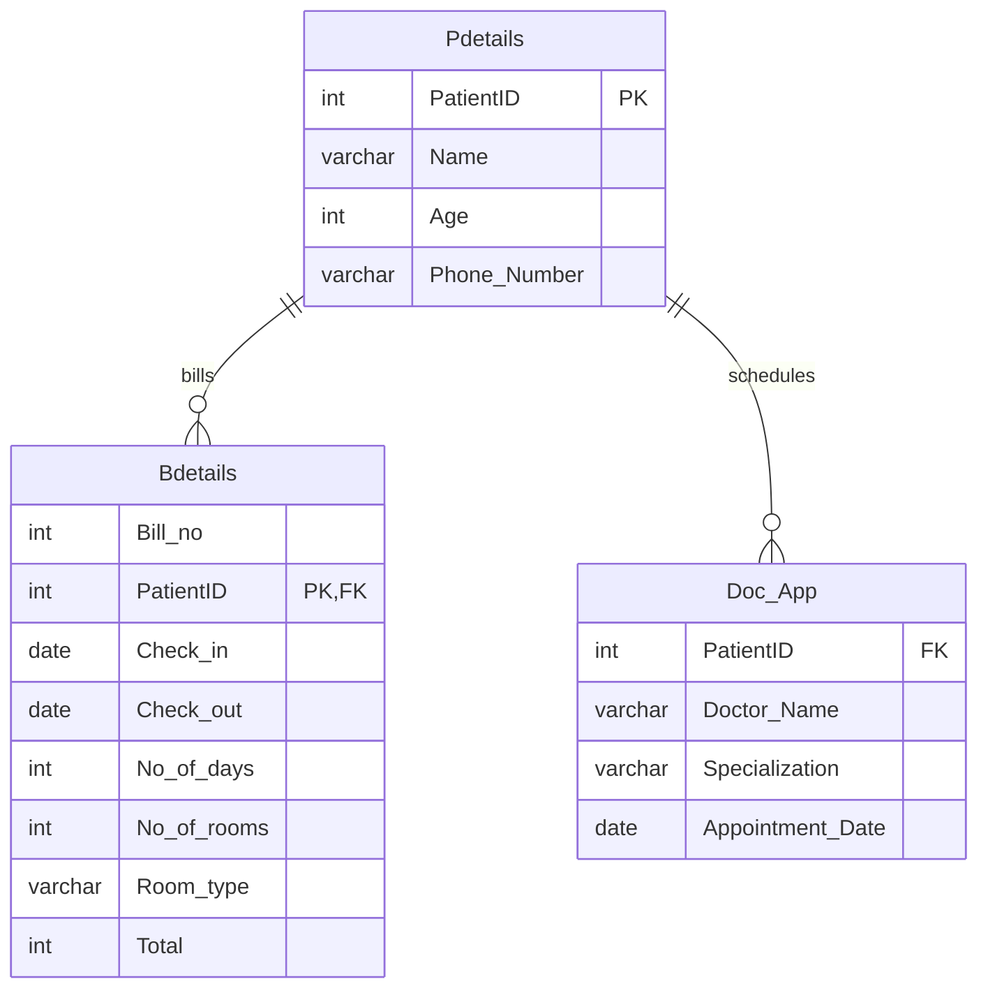

# City Hospital Management System 🏥

### Relational Database Management System (DBMS) CLI for Patient Registration, Room Allocation & Appointments

[](https://www.python.org/)
[](https://www.mysql.com/)
[](https://github.com/Amrit-04/Hospital-management-system)
[](https://pypi.org/project/tabulate/)
[](https://opensource.org/licenses/MIT)

The City Hospital Management System is an end-to-end relational database application built in Python with a MySQL backend. It streamlines inpatient room assignment, stay billing, doctor appointment scheduling, and patient record management through a structured terminal interface.

---

## 🛠️ Core Features

- **🏨 Inpatient Room Allocation & Stay Billing:**
  - Automated room assignment across room categories (General Ward, Semi-Private, Deluxe).
  - Calculates length of stay (`Check_out - Check_in`) and total bill amount dynamically.
- **👨‍⚕️ Doctor Appointment Booking:**
  - Schedules appointments with specialized physicians (Cardiology, Orthopedics, Pediatrics, General Medicine).
  - Validates and links patient IDs with allocated time slots.
- **📋 Patient Master Records:**
  - Secure patient registration with validated contact numbers, age, and unique Patient IDs.
- **📊 Clean Tabular Reporting:**
  - Formatted ASCII tables using `tabulate` for bills, appointment rosters, and patient manifests.

---

## 🗄️ Relational Database Schema



---

## 🚀 Setup & Installation

### Prerequisites

- [Python](https://www.python.org/) 3.8+
- [MySQL Server](https://dev.mysql.com/downloads/) installed and running locally

### Installation

1. **Clone the repository:**
   ```bash
   git clone https://github.com/Amrit-04/Hospital-management-system.git
   cd Hospital-management-system
   ```

2. **Install Python dependencies:**
   ```bash
   pip install mysql-connector-python tabulate
   ```

3. **Configure Database Credentials:**
   Open `hospital management pps.py` and update the MySQL connection parameters if your local MySQL user/password differs:
   ```python
   conobj = mysql.connector.connect(
       host="localhost",
       user="root",
       password="your_mysql_password"
   )
   ```

4. **Launch the Application:**
   ```bash
   python "hospital management pps.py"
   ```
   The application automatically creates the `hospital` database and required tables on its first run.

---

## 💻 CLI Menu Navigation

```
========================== CITY HOSPITAL MANAGEMENT ==========================
                        1. Assign a Room
                        2. Book an Appointment
                        3. Exit
======================================================================
```

---

## 📄 License

This project is licensed under the MIT License.